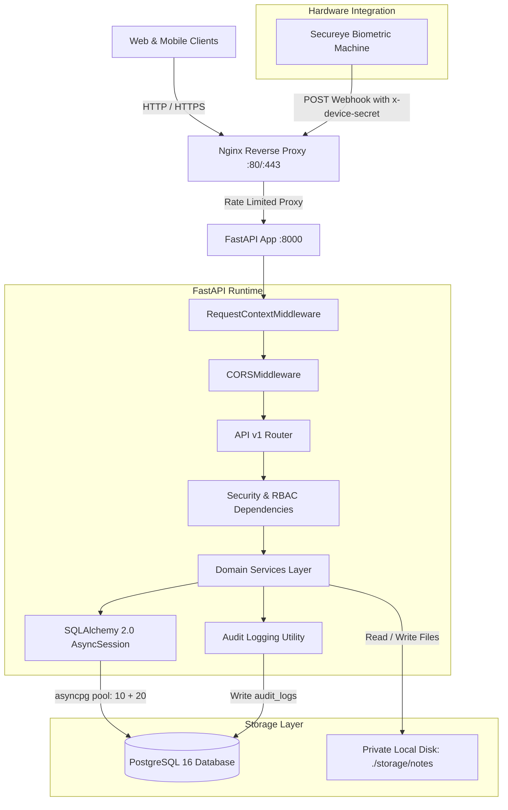
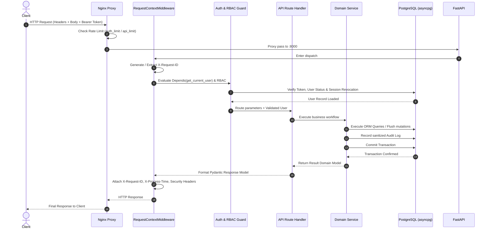

# FUNDAMICS LMS Backend — Architecture & System Design

This document details the architectural principles, component topology, request lifecycle, and data flow of the FUNDAMICS Coaching Centre LMS backend.

---

## 1. Architectural Topology

The system is built as a modular, asynchronous RESTful API service leveraging FastAPI, SQLAlchemy 2.0 (Async), and PostgreSQL 16. It is designed to reliably serve concurrent requests from a React Admin Web Portal and React Native / Expo mobile clients.



---

## 2. Layered Architecture & Separation of Concerns

The codebase enforces strict unidirectional dependency boundaries:

```
src/
  ├── api/v1/          --> Presentation Layer (Routing, HTTP parsing, Status codes)
  ├── schemas/         --> Contract & Validation Layer (Pydantic V2 DTOs)
  ├── core/            --> Cross-Cutting Concerns (Auth, Permissions, Exceptions, Middleware)
  ├── services/        --> Domain Logic & Calculation Layer (Atomic business transactions)
  ├── models/          --> Data Definition Layer (Declarative SQLAlchemy ORM entities)
  ├── database.py      --> Connection Pool & Session Management (Engine, AsyncSessionLocal)
  └── config.py        --> Environment Settings (Pydantic BaseSettings)
```

### Layer Responsibilities

1. **Presentation Layer (`src/api/v1/`)**:
   - Declares path operations, tags, request methods, and response models.
   - Enforces authentication and authorization dependencies before invoking services.
   - Converts HTTP request payloads and query parameters to Pydantic models.
   - Never writes direct database queries or raw SQL.

2. **Validation & Contract Layer (`src/schemas/`)**:
   - Enforces strict input validation with `ConfigDict(extra="forbid")`.
   - Serializes outgoing database models via `ConfigDict(from_attributes=True)`.
   - Validates data formats (e.g., `EmailStr`, date constraints, length bounds).

3. **Core Layer (`src/core/`)**:
   - `security.py`: Password hashing (bcrypt) and JWT encode/decode logic.
   - `dependencies.py`: Request-scoped `get_current_user` resolving bearer tokens and validating database sessions.
   - `permissions.py`: Role enforcement guards (`require_admin`, `require_teacher`, `require_student`).
   - `exceptions.py`: Custom application exceptions mapped to standardized HTTP responses.
   - `middleware.py`: Generates `X-Request-ID`, calculates `X-Process-Time`, and adds defensive security headers.
   - `audit.py`: Sanitizes sensitive keys and writes immutable records to `audit_logs`.

4. **Service Layer (`src/services/`)**:
   - Encapsulates domain business logic, data aggregation, and workflow validation.
   - Coordinates multi-entity database mutations inside atomic transactions.
   - Directly calls `record_audit_log` for critical state changes.

5. **Persistence Layer (`src/models/` & `src/database.py`)**:
   - Defines PostgreSQL tables and relations via SQLAlchemy 2.0 `Mapped` attributes.
   - All models inherit common audit fields (`id`, `created_at`, `updated_at`) from `TimeStampedUUIDModel`.
   - Asynchronous execution driven by `asyncpg` with a connection pool size of 10 and max overflow of 20.

---

## 3. Request-Response Lifecycle



---

## 4. Key Design Patterns

### 1. Session-Per-Request Pattern
Database sessions are managed via FastAPI's dependency injection (`get_db` in [src/database.py](file:///d:/fundamics_backend/src/database.py)):
- Yields an isolated `AsyncSession` per HTTP request.
- Automatically executes `session.rollback()` if an unhandled exception occurs.
- Automatically closes the session in a `finally` block to prevent connection leaks.

### 2. Rotating Refresh Token Session Pattern
Rather than relying on stateless refresh tokens, the application maintains persistent sessions in the `auth_sessions` table:
- Raw refresh tokens are 48-byte URL-safe strings generated cryptographically.
- Database stores only a SHA-256 digest of the refresh token.
- When `/api/v1/auth/refresh` is called, the old session is invalidated (`revoked_at = now`) and an entirely new session and token are issued.
- If an access token with a revoked `session_id` is presented, authentication fails immediately.

### 3. Sanitized Immutable Audit Trail
The `record_audit_log` helper in [src/core/audit.py](file:///d:/fundamics_backend/src/core/audit.py) ensures:
- Every major administrative mutation (creating students, publishing results, changing settings, importing attendance) writes a structured entry to `audit_logs`.
- Pre-write sanitization scrubs sensitive fields (`password`, `token`, `secret`, `secret_reference`) by replacing values with `[REDACTED]`.

### 4. Zero-IDOR Scoped Authorization
Students and Teachers query data using their authenticated credentials rather than user IDs provided in query parameters:
- Student attendance: `/api/v1/student/me/attendance/summary` extracts `current_user.student.id`.
- Student exam results: `/api/v1/student/me/results` extracts `current_user.student.id` and queries strictly where `published_at IS NOT NULL`.
- Study notes access: File downloads verify the student is enrolled in the matching `class_id` and optional `batch_id`.
