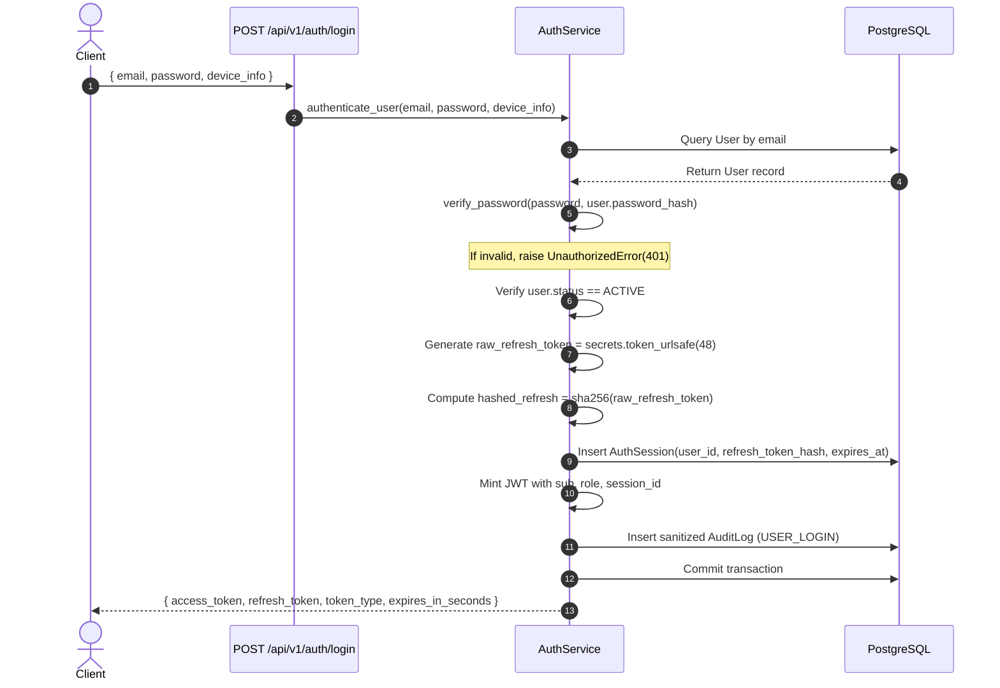
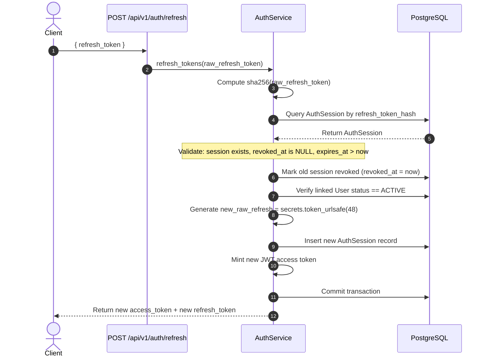

# FUNDAMICS LMS Backend — Authentication & Authorization

This document details the authentication architecture, token lifecycle, session management, and Role-Based Access Control (RBAC) mechanisms implemented in the backend.

---

## 1. Authentication Overview

The system uses a stateful session-backed JWT (JSON Web Token) architecture:
- **Access Tokens:** Short-lived (15 minutes), signed using HMAC-SHA256 (`HS256`).
- **Refresh Tokens:** Long-lived (7 days), cryptographically secure 48-byte random strings stored as SHA-256 digests in the `auth_sessions` database table.
- **Session Tracking & Invalidation:** Every issued JWT carries a `session_id`. Revoking a session immediately invalidates both the refresh token and any corresponding access tokens.

---

## 2. Password Handling & Security

- **Algorithm:** `bcrypt` with automatic salt generation (`bcrypt.gensalt()`).
- **Implementation:** [src/core/security.py](file:///d:/fundamics_backend/src/core/security.py)
  ```python
  def hash_password(password: str) -> str:
      pwd_bytes = password.encode("utf-8")
      salt = bcrypt.gensalt()
      return bcrypt.hashpw(pwd_bytes, salt).decode("utf-8")

  def verify_password(plain_password: str, hashed_password: str) -> bool:
      try:
          return bcrypt.checkpw(plain_password.encode("utf-8"), hashed_password.encode("utf-8"))
      except Exception:
          return False
  ```
- **Password Policies:** Enforced via Pydantic schemas (min 6–8 chars, max 128 chars).

---

## 3. JWT Claims Structure

Access tokens are minted with standard and custom claims:

```json
{
  "sub": "c1f7a63e-2b5d-4f38-9441-2a623048995a",
  "role": "STUDENT",
  "session_id": "90e0b3c1-0268-45e3-9e4f-2d7ecfbb4712",
  "iat": 1727770000,
  "exp": 1727770900
}
```

| Claim | Type | Description |
| :--- | :--- | :--- |
| `sub` | String (UUID) | The primary key `users.id` of the authenticated user. |
| `role` | String | User role (`ADMIN`, `TEACHER`, or `STUDENT`). |
| `session_id` | String (UUID) | Primary key of the active session record in `auth_sessions`. |
| `iat` | Integer | Epoch timestamp when the token was issued. |
| `exp` | Integer | Epoch timestamp when the token expires (default: `iat + 15 mins`). |

---

## 4. End-to-End Authentication Flows

### Flow A: Login & Session Initialization


### Flow B: Refresh Token Rotation


### Flow C: Authenticated Request & Session Validation
When an incoming request presents an access token:
1. `get_current_user` extracts the `Authorization: Bearer <token>` header.
2. Decodes and verifies the signature using `settings.JWT_SECRET_KEY`.
3. Resolves the user from the database eager-loading `User.student` and `User.teacher`.
4. Checks `user.status == UserStatus.ACTIVE`.
5. If `session_id` is present in the token claims, queries `auth_sessions`:
   - If session record does not exist or `revoked_at IS NOT NULL`, immediately raises `401 Unauthorized ("Session has been revoked or expired")`.

---

## 5. Role-Based Access Control (RBAC)

The system defines 3 distinct roles in `src/models/user.py`:

```python
class UserRole(str, enum.Enum):
    ADMIN = "ADMIN"
    TEACHER = "TEACHER"
    STUDENT = "STUDENT"
```

Role enforcement is handled via FastAPI dependency functions in [src/core/permissions.py](file:///d:/fundamics_backend/src/core/permissions.py):

| Dependency | Required Role | Profile Check | Behavior on Failure |
| :--- | :--- | :--- | :--- |
| `require_admin` | `UserRole.ADMIN` | None | Raises `403 Forbidden ("Administrator access required")` |
| `require_teacher` | `UserRole.TEACHER` | `current_user.teacher` must exist | Raises `403 Forbidden ("Teacher access required" or "Teacher profile record not found")` |
| `require_student` | `UserRole.STUDENT` | `current_user.student` must exist | Raises `403 Forbidden ("Student access required" or "Student profile record not found")` |

---

## 6. Registration & Account Creation

There is **no public self-registration endpoint**. All accounts are provisioned administratively:
- **Students:** Created by Admin via `POST /api/v1/admin/students`. The service validates academic class and batch, sets up the student profile, assigns an initial password (or generates a secure temporary one), and creates the initial class enrollment.
- **Teachers:** Created by Admin via `POST /api/v1/admin/teachers`. Links a `teacher_code` and optional `biometric_employee_id`.

---

## 7. Password Reset & Verification Status

Database tables and schemas exist for:
- `verification_tokens` (`token_hash`, `expires_at`, `used_at`)
- `password_reset_tokens` (`token_hash`, `expires_at`, `used_at`)
- Schemas: `ChangePasswordRequest`, `ForgotPasswordRequest`, `ResetPasswordRequest` in [src/schemas/auth.py](file:///d:/fundamics_backend/src/schemas/auth.py).

> [!NOTE]
> Public API routes for forgot password and reset password have not yet been wired into `src/api/v1/auth.py`. They exist as pre-designed models and schemas ready for email provider integration.
