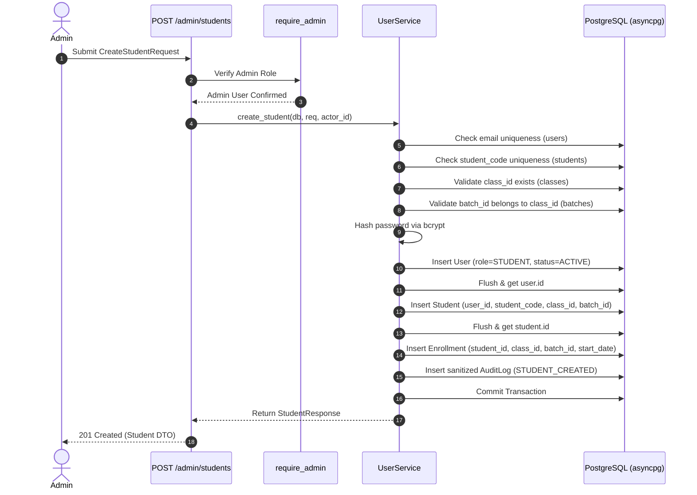
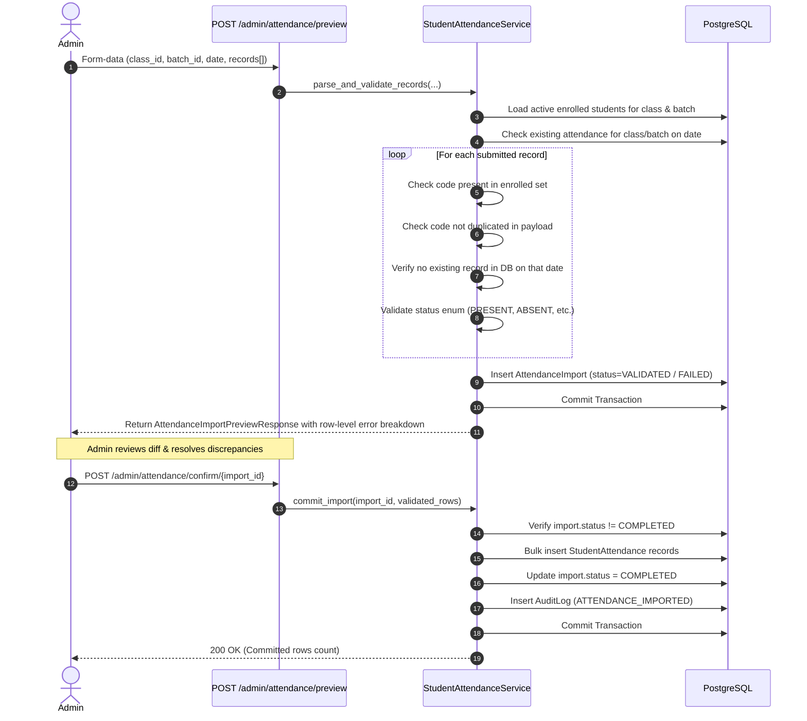
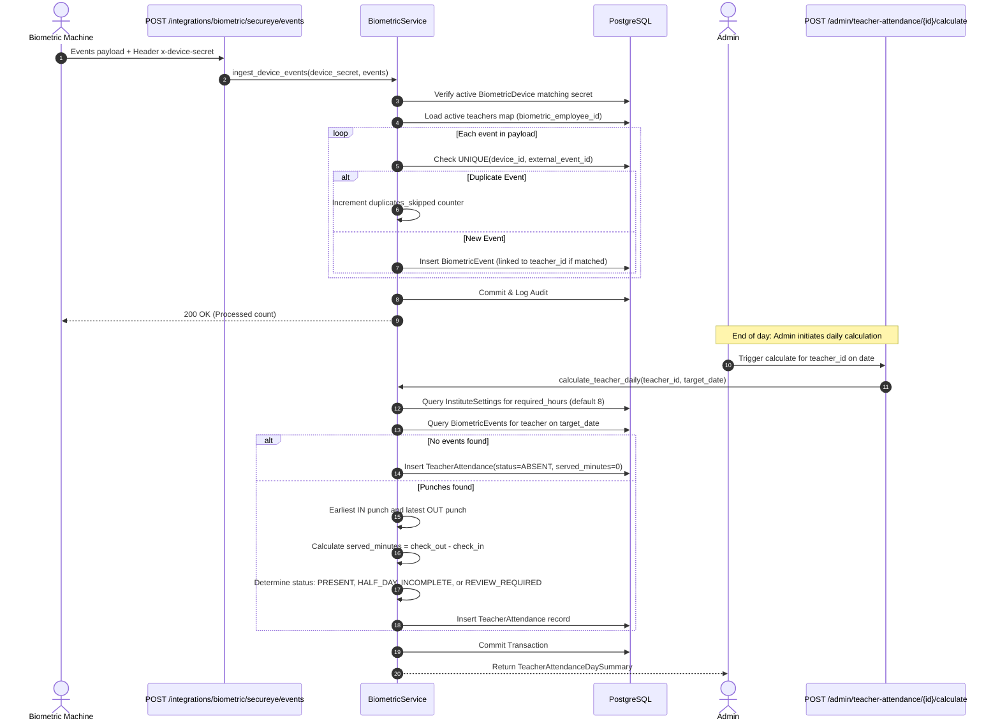
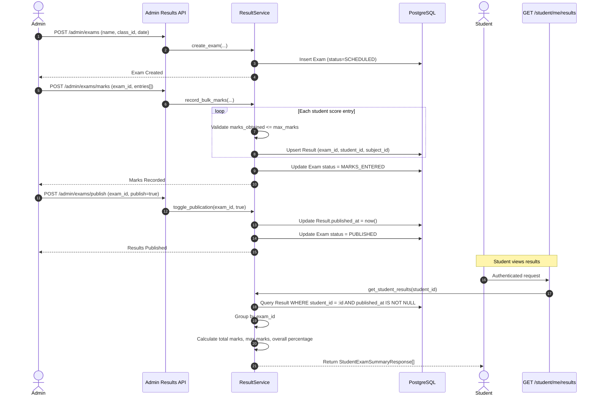
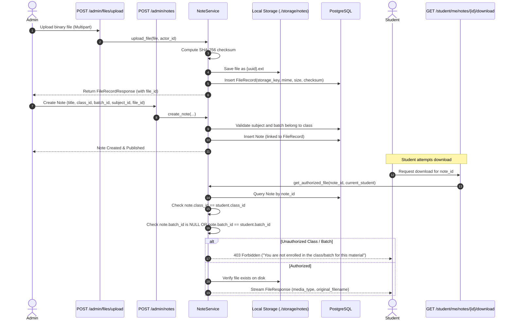

# FUNDAMICS LMS Backend — Business Workflows & Execution Traces

This document traces the primary business flows of the FUNDAMICS LMS backend, mapping the execution path through Route $\to$ Dependency $\to$ Service $\to$ Database $\to$ Audit Log $\to$ Response.

---

## 1. Student Onboarding & Enrollment Flow

### Overview
Administrators onboard students directly. The backend validates academic references, provisions the underlying user authentication record, builds the student profile, and establishes the active class enrollment within an atomic transaction.

### Business Rules & Safeguards
1. **Email Uniqueness:** Rejects duplicates with `409 Conflict`.
2. **Student Code Uniqueness:** Code must be unique across the entire institute; rejects duplicates with `409 Conflict`.
3. **Hierarchy Integrity:** Validates `batch.class_id == req.class_id`. A student cannot be assigned to a batch belonging to another class (`422 Unprocessable Entity`).
4. **Temporary Password Generation:** If an admin leaves the password empty, the system generates a secure 12-character random string via `secrets.token_urlsafe(12)`.
5. **Atomic Commit:** If any part of the user, student profile, or enrollment fails, the entire transaction rolls back cleanly.

---

## 2. Student Attendance Two-Phase Staging Flow

### Overview
Student attendance is processed using a two-stage pattern (Stage 1: Preview & Validate $\to$ Stage 2: Confirm & Commit) to prevent corrupted or duplicate records.

### Business Rules & Safeguards
- **Duplicate Prevention:** The database enforces a `UNIQUE(student_id, date)` constraint. The validation stage proactively verifies this constraint before inserting rows.
- **Strict Roster Scoping:** Unenrolled students are rejected with an explicit validation error: `"Student code 'XYZ' not enrolled in this class/batch"`.
- **Zero IDOR Analytics:** When students request their attendance summary (`/student/me/attendance/summary`), the endpoint reads `current_user.student.id` directly from the authenticated session, ensuring students can never query other students' attendance.

---

## 3. Biometric Ingestion & Teacher Attendance Calculation

### Overview
Integrates physical Secureye biometric devices via webhook ingestion followed by administrative calculation against institute service hours.

---

## 4. Exam Results Lifecycle & GPA Calculation

### Overview
Handles the academic evaluation lifecycle: Exam container creation $\to$ Bulk marks entry $\to$ Administrative publication $\to$ Student report card access.

### Business Rules & Safeguards
1. **Score Bound Invariant:** `marks_obtained` must never exceed `max_marks`. Rejects invalid inputs with `422 Unprocessable Entity`.
2. **Draft Result Privacy:** Results with `published_at IS NULL` are strictly hidden from student queries. Even if marks are saved in the database, students cannot view them until the admin explicitly triggers `/admin/exams/publish`.
3. **Compound Key Uniqueness:** Results are constrained by `UNIQUE(exam_id, student_id, subject_id)`. Re-submitting marks for an existing exam/student/subject cleanly updates the score.

---

## 5. Notes & Study Materials Upload & Authorization Flow

### Overview
Manages uploaded educational materials stored in local private disk storage (`./storage/notes`) and ensures access is restricted to students actively enrolled in the relevant class and batch.

