# FUNDAMICS LMS Backend — Database Architecture & Schema Specification

This document provides the complete, authoritative specification of the PostgreSQL database schema, relational models, constraints, and migration management.

---

## 1. Engine & Connection Configuration

- **Database Engine:** PostgreSQL 16
- **Driver:** `asyncpg` (Async application runtime) & `psycopg2-binary` (Synchronous Alembic migrations / tooling fallback)
- **Timezone Convention:** All timestamps are stored with time zone in UTC (`DateTime(timezone=True)`). Business reporting defaults to `Asia/Kolkata`.
- **Primary Key Standard:** UUID Version 4 generated automatically via `uuid.uuid4`.
- **Pool Settings:**
  - `pool_size`: 10 persistent connections
  - `max_overflow`: 20 burst connections
  - `pool_pre_ping`: True (validates connection health before issuing queries)
  - `echo`: Controlled by `DEBUG` setting

---

## 2. Verification Status

| Component | Source of Truth | Verification Status |
| :--- | :--- | :--- |
| **SQLAlchemy Models** | Python code in `src/models/*.py` | **VERIFIED FROM CODE** |
| **Schema Migrations** | `alembic/versions/549197cf5a09_initial_schema.py` | **VERIFIED FROM SCHEMA** |
| **Live Database Instance** | Local / Staging PostgreSQL server | **NOT VERIFIED** (Database container was offline during codebase audit) |

---

## 3. Entity-Relationship Diagram (ERD)

```mermaid
erDiagram
    users ||--o| students : "has profile (1:1)"
    users ||--o| teachers : "has profile (1:1)"
    users ||--o{ auth_sessions : "maintains"
    users ||--o{ audit_logs : "records as actor"
    users ||--o{ attendance_imports : "uploads"
    users ||--o{ files : "creates"
    users ||--o{ notes : "authors"
    users ||--o{ academic_calendar_events : "creates"
    users ||--o{ verification_tokens : "issued to"
    users ||--o{ password_reset_tokens : "issued to"

    classes ||--o{ batches : "contains"
    classes ||--o{ subjects : "contains"
    classes ||--o{ enrollments : "enrolled in"
    classes ||--o{ exams : "hosts"
    classes ||--o{ notes : "assigned to"

    students ||--o{ enrollments : "has"
    students ||--o{ student_attendance : "tracked in"
    students ||--o{ results : "achieves"

    batches ||--o{ enrollments : "assigned to"

    attendance_imports ||--o{ student_attendance : "generates batch"

    biometric_devices ||--o{ biometric_events : "registers"
    teachers ||--o{ biometric_events : "identified in"
    teachers ||--o{ teacher_attendance : "calculated for"

    exams ||--o{ results : "records marks"
    subjects ||--o{ results : "evaluated in"
    subjects ||--o{ notes : "categorized by"

    files ||--o{ notes : "attached to"
```

---

## 4. Complete Table Specifications (23 Models)

All 23 relational models inherit from `TimeStampedUUIDModel` ([src/models/base.py](file:///d:/fundamics_backend/src/models/base.py)):
- `id`: `UUID(as_uuid=True)`, Primary Key, Indexed, Default: `uuid.uuid4`
- `created_at`: `DateTime(timezone=True)`, Non-nullable, Default: `datetime.now(timezone.utc)`
- `updated_at`: `DateTime(timezone=True)`, Non-nullable, Default: `datetime.now(timezone.utc)`, onupdate: `datetime.now(timezone.utc)`

---

### 1. `users`
Core user identity for system authentication.

| Column | Type | Constraints | Description |
| :--- | :--- | :--- | :--- |
| `id` | UUID | PK | User identifier |
| `role` | VARCHAR(20) | NOT NULL, INDEX | Enum: `ADMIN`, `TEACHER`, `STUDENT` |
| `name` | VARCHAR(150) | NOT NULL | Full name of the user |
| `email` | VARCHAR(255) | UNIQUE, NOT NULL, INDEX | Primary email login identifier |
| `phone` | VARCHAR(20) | NULLABLE | Primary phone number |
| `password_hash` | VARCHAR(255) | NOT NULL | Bcrypt hashed password |
| `status` | VARCHAR(30) | NOT NULL, DEFAULT: `PENDING_VERIFICATION` | Enum: `ACTIVE`, `PENDING_VERIFICATION`, `SUSPENDED`, `INACTIVE` |
| `email_verified_at`| TIMESTAMPTZ | NULLABLE | Verification timestamp |

---

### 2. `students`
Student profile linked 1-to-1 to a user record.

| Column | Type | Constraints | Description |
| :--- | :--- | :--- | :--- |
| `id` | UUID | PK | Student identifier |
| `user_id` | UUID | UNIQUE, NOT NULL, FK(`users.id` ON DELETE CASCADE) | Linked user account |
| `student_code` | VARCHAR(50) | UNIQUE, NOT NULL, INDEX | Unique student roll/registration code |
| `class_id` | UUID | NOT NULL, FK(`classes.id` ON DELETE RESTRICT) | Current academic class |
| `batch_id` | UUID | NOT NULL, FK(`batches.id` ON DELETE RESTRICT) | Current active batch |
| `admission_date` | DATE | NOT NULL | Official date of admission |
| `status` | VARCHAR(30) | NOT NULL, DEFAULT: `ACTIVE` | Student profile status |

---

### 3. `teachers`
Teacher profile linked 1-to-1 to a user record.

| Column | Type | Constraints | Description |
| :--- | :--- | :--- | :--- |
| `id` | UUID | PK | Teacher identifier |
| `user_id` | UUID | UNIQUE, NOT NULL, FK(`users.id` ON DELETE CASCADE) | Linked user account |
| `teacher_code` | VARCHAR(50) | UNIQUE, NOT NULL, INDEX | Unique faculty identifier |
| `biometric_employee_id` | VARCHAR(100) | UNIQUE, NULLABLE, INDEX | External ID configured in biometric device |
| `status` | VARCHAR(30) | NOT NULL, DEFAULT: `ACTIVE` | Faculty active status |

---

### 4. `classes`
Academic class or course container.

| Column | Type | Constraints | Description |
| :--- | :--- | :--- | :--- |
| `id` | UUID | PK | Class identifier |
| `name` | VARCHAR(100) | NOT NULL | Class name (e.g. "Class 11 Science") |
| `code` | VARCHAR(50) | UNIQUE, NOT NULL, INDEX | Class code (e.g. "CLS-11-SCI") |
| `academic_year` | VARCHAR(20) | NOT NULL | Academic session (e.g. "2026-2027") |
| `status` | VARCHAR(30) | NOT NULL, DEFAULT: `ACTIVE` | Operational status |

---

### 5. `batches`
Time-based cohort belonging to a class.

| Column | Type | Constraints | Description |
| :--- | :--- | :--- | :--- |
| `id` | UUID | PK | Batch identifier |
| `class_id` | UUID | NOT NULL, FK(`classes.id` ON DELETE CASCADE) | Parent class |
| `name` | VARCHAR(100) | NOT NULL | Batch title |
| `code` | VARCHAR(50) | NOT NULL | Batch code within class |
| `start_time` | TIME | NOT NULL | Daily batch start time |
| `end_time` | TIME | NOT NULL | Daily batch end time |
| `status` | VARCHAR(30) | NOT NULL, DEFAULT: `ACTIVE` | Operational status |

- **Table Constraints:** `UNIQUE (class_id, code)`

---

### 6. `subjects`
Academic subject offered within a class.

| Column | Type | Constraints | Description |
| :--- | :--- | :--- | :--- |
| `id` | UUID | PK | Subject identifier |
| `class_id` | UUID | NOT NULL, FK(`classes.id` ON DELETE CASCADE) | Parent class |
| `name` | VARCHAR(100) | NOT NULL | Subject name |
| `code` | VARCHAR(50) | NOT NULL | Subject code |
| `status` | VARCHAR(30) | NOT NULL, DEFAULT: `ACTIVE` | Operational status |

- **Table Constraints:** `UNIQUE (class_id, code)`

---

### 7. `enrollments`
Historical and current student enrollment tracking.

| Column | Type | Constraints | Description |
| :--- | :--- | :--- | :--- |
| `id` | UUID | PK | Enrollment identifier |
| `student_id` | UUID | NOT NULL, FK(`students.id` ON DELETE CASCADE) | Enrolled student |
| `class_id` | UUID | NOT NULL, FK(`classes.id` ON DELETE RESTRICT) | Enrolled class |
| `batch_id` | UUID | NOT NULL, FK(`batches.id` ON DELETE RESTRICT) | Enrolled batch |
| `start_date` | DATE | NOT NULL | Enrollment start date |
| `end_date` | DATE | NULLABLE | Enrollment completion date |
| `status` | VARCHAR(30) | NOT NULL, DEFAULT: `ACTIVE` | Enrollment status |

---

### 8. `attendance_imports`
Tracks bulk attendance staging operations.

| Column | Type | Constraints | Description |
| :--- | :--- | :--- | :--- |
| `id` | UUID | PK | Import session identifier |
| `uploaded_by` | UUID | NOT NULL, FK(`users.id` ON DELETE RESTRICT) | Admin actor |
| `class_id` | UUID | NOT NULL | Target class UUID |
| `batch_id` | UUID | NOT NULL | Target batch UUID |
| `from_date` | DATE | NOT NULL | Attendance date span start |
| `to_date` | DATE | NOT NULL | Attendance date span end |
| `filename` | VARCHAR(255) | NOT NULL | Uploaded file name reference |
| `status` | VARCHAR(30) | NOT NULL, DEFAULT: `PENDING_VALIDATION` | Enum: `PENDING_VALIDATION`, `VALIDATED`, `COMPLETED`, `FAILED` |
| `total_rows` | INTEGER | NOT NULL, DEFAULT: 0 | Total submitted rows |
| `valid_rows` | INTEGER | NOT NULL, DEFAULT: 0 | Passed validation count |
| `error_rows` | INTEGER | NOT NULL, DEFAULT: 0 | Failed validation count |
| `completed_at`| TIMESTAMPTZ | NULLABLE | Commit timestamp |

---

### 9. `student_attendance`
Daily individual student attendance records.

| Column | Type | Constraints | Description |
| :--- | :--- | :--- | :--- |
| `id` | UUID | PK | Attendance entry ID |
| `student_id` | UUID | NOT NULL, INDEX, FK(`students.id` ON DELETE CASCADE) | Target student |
| `class_id` | UUID | NOT NULL, INDEX, FK(`classes.id` ON DELETE RESTRICT) | Associated class |
| `batch_id` | UUID | NOT NULL, INDEX, FK(`batches.id` ON DELETE RESTRICT) | Associated batch |
| `date` | DATE | NOT NULL, INDEX | Attendance calendar date |
| `status` | VARCHAR(20) | NOT NULL | Enum: `PRESENT`, `ABSENT`, `LATE`, `EXCUSED`, `HOLIDAY` |
| `remarks` | VARCHAR(255) | NULLABLE | Optional notes |
| `source` | VARCHAR(50) | NOT NULL, DEFAULT: `EXCEL_IMPORT` | Data origin |
| `import_id` | UUID | NULLABLE, FK(`attendance_imports.id` ON DELETE SET NULL) | Originating import batch |

- **Table Constraints:** `UNIQUE (student_id, date)`

---

### 10. `biometric_devices`
Hardware registry for biometric attendance machines.

| Column | Type | Constraints | Description |
| :--- | :--- | :--- | :--- |
| `id` | UUID | PK | Device identifier |
| `external_device_id` | VARCHAR(100) | UNIQUE, NOT NULL, INDEX | Serial / Hardware ID |
| `name` | VARCHAR(100) | NOT NULL | Human-readable location name |
| `model` | VARCHAR(100) | NULLABLE | Hardware model |
| `secret_reference` | VARCHAR(255) | NOT NULL | Pre-shared webhook secret |
| `status` | VARCHAR(30) | NOT NULL, DEFAULT: `ACTIVE` | Device operational status |
| `last_seen_at` | TIMESTAMPTZ | NULLABLE | Latest heartbeat timestamp |

---

### 11. `biometric_events`
Raw punch events received from biometric hardware.

| Column | Type | Constraints | Description |
| :--- | :--- | :--- | :--- |
| `id` | UUID | PK | Event identifier |
| `device_id` | UUID | NOT NULL, INDEX, FK(`biometric_devices.id` ON DELETE CASCADE) | Originating device |
| `external_event_id` | VARCHAR(150) | NOT NULL | Unique punch ID from hardware |
| `employee_identifier` | VARCHAR(100) | NOT NULL, INDEX | Punch ID from hardware card/fingerprint |
| `teacher_id` | UUID | NULLABLE, INDEX, FK(`teachers.id` ON DELETE SET NULL) | Matched teacher |
| `event_type` | VARCHAR(10) | NOT NULL | Enum: `IN`, `OUT` |
| `event_at_utc` | TIMESTAMPTZ | NOT NULL, INDEX | Punch timestamp |
| `raw_reference` | TEXT | NULLABLE | Raw payload if stored |
| `received_at` | TIMESTAMPTZ | NOT NULL | Ingestion timestamp |

- **Table Constraints:** `UNIQUE (device_id, external_event_id)`

---

### 12. `teacher_attendance`
Daily aggregated faculty attendance calculated from punch logs.

| Column | Type | Constraints | Description |
| :--- | :--- | :--- | :--- |
| `id` | UUID | PK | Attendance entry ID |
| `teacher_id` | UUID | NOT NULL, INDEX, FK(`teachers.id` ON DELETE CASCADE) | Target teacher |
| `date` | DATE | NOT NULL, INDEX | Calendar date |
| `check_in_at` | TIMESTAMPTZ | NULLABLE | Earliest `IN` punch |
| `check_out_at`| TIMESTAMPTZ | NULLABLE | Latest `OUT` punch |
| `served_minutes` | INTEGER | NOT NULL, DEFAULT: 0 | Total service duration in minutes |
| `required_minutes`| INTEGER | NOT NULL, DEFAULT: 0 | Institute requirement in minutes |
| `status` | VARCHAR(30) | NOT NULL | Enum: `PRESENT`, `ABSENT`, `HALF_DAY`, `INCOMPLETE`, `REVIEW_REQUIRED`, `HOLIDAY` |
| `calculation_version` | INTEGER | NOT NULL, DEFAULT: 1 | Schema calculation iteration |
| `source` | VARCHAR(50) | NOT NULL, DEFAULT: `BIOMETRIC` | Record origin |

- **Table Constraints:** `UNIQUE (teacher_id, date)`

---

### 13. `exams`
Exam container entity.

| Column | Type | Constraints | Description |
| :--- | :--- | :--- | :--- |
| `id` | UUID | PK | Exam identifier |
| `class_id` | UUID | NOT NULL, INDEX, FK(`classes.id` ON DELETE RESTRICT) | Target class |
| `batch_id` | UUID | NULLABLE, INDEX, FK(`batches.id` ON DELETE SET NULL) | Specific batch (if restricted) |
| `name` | VARCHAR(150) | NOT NULL | Exam title |
| `date` | DATE | NOT NULL | Scheduled exam date |
| `status` | VARCHAR(30) | NOT NULL, DEFAULT: `SCHEDULED` | Status: `SCHEDULED`, `MARKS_ENTERED`, `PUBLISHED` |

---

### 14. `results`
Student academic score entries.

| Column | Type | Constraints | Description |
| :--- | :--- | :--- | :--- |
| `id` | UUID | PK | Result entry ID |
| `exam_id` | UUID | NOT NULL, INDEX, FK(`exams.id` ON DELETE CASCADE) | Associated exam |
| `student_id` | UUID | NOT NULL, INDEX, FK(`students.id` ON DELETE CASCADE) | Evaluated student |
| `subject_id` | UUID | NOT NULL, INDEX, FK(`subjects.id` ON DELETE RESTRICT) | Evaluated subject |
| `marks_obtained` | NUMERIC(6,2)| NOT NULL | Achieved score |
| `max_marks` | NUMERIC(6,2)| NOT NULL | Total possible score |
| `grade` | VARCHAR(10) | NULLABLE | Letter grade |
| `published_at` | TIMESTAMPTZ | NULLABLE, INDEX | Publication timestamp (NULL = Draft) |

- **Table Constraints:** `UNIQUE (exam_id, student_id, subject_id)`

---

### 15. `files`
Metadata for binary files stored in private object/disk storage.

| Column | Type | Constraints | Description |
| :--- | :--- | :--- | :--- |
| `id` | UUID | PK | File record identifier |
| `storage_key` | VARCHAR(500) | UNIQUE, NOT NULL, INDEX | Absolute disk path or storage key |
| `original_filename`| VARCHAR(255) | NOT NULL | Original client filename |
| `mime_type` | VARCHAR(100) | NOT NULL | Detected MIME type |
| `size_bytes` | BIGINT | NOT NULL | File size in bytes |
| `checksum` | VARCHAR(64) | NULLABLE | SHA-256 integrity hash |
| `visibility` | VARCHAR(30) | NOT NULL, DEFAULT: `PRIVATE` | Access privacy scope |
| `created_by` | UUID | NOT NULL, FK(`users.id` ON DELETE RESTRICT) | Uploader user |

---

### 16. `notes`
Study material metadata records.

| Column | Type | Constraints | Description |
| :--- | :--- | :--- | :--- |
| `id` | UUID | PK | Note identifier |
| `title` | VARCHAR(200) | NOT NULL | Note title |
| `description` | TEXT | NULLABLE | Description / instructions |
| `class_id` | UUID | NOT NULL, INDEX, FK(`classes.id` ON DELETE CASCADE) | Target class |
| `batch_id` | UUID | NULLABLE, INDEX, FK(`batches.id` ON DELETE SET NULL) | Target batch (NULL = entire class) |
| `subject_id` | UUID | NOT NULL, INDEX, FK(`subjects.id` ON DELETE RESTRICT) | Academic subject |
| `file_id` | UUID | NOT NULL, INDEX, FK(`files.id` ON DELETE RESTRICT) | Attached binary file |
| `status` | VARCHAR(30) | NOT NULL, DEFAULT: `PUBLISHED`, INDEX | Publication status |
| `created_by` | UUID | NOT NULL, FK(`users.id` ON DELETE RESTRICT) | Author admin user |

---

### 17. `academic_calendar_events`
Institute calendar entries.

| Column | Type | Constraints | Description |
| :--- | :--- | :--- | :--- |
| `id` | UUID | PK | Calendar event ID |
| `title` | VARCHAR(150) | NOT NULL | Event name |
| `date` | DATE | NOT NULL, INDEX | Event date |
| `type` | VARCHAR(30) | NOT NULL | Enum: `HOLIDAY`, `CLOSED`, `EXAM`, `SPECIAL_CLASS` |
| `applies_to` | VARCHAR(50) | NOT NULL, DEFAULT: `ALL` | Scope: `ALL`, `TEACHERS`, `STUDENTS` |
| `class_id` | UUID | NULLABLE | Class scope if specific |
| `batch_id` | UUID | NULLABLE | Batch scope if specific |
| `created_by` | UUID | NOT NULL, FK(`users.id` ON DELETE RESTRICT) | Creator admin user |

---

### 18. `notification_records`
Delivery log for outgoing communications.

| Column | Type | Constraints | Description |
| :--- | :--- | :--- | :--- |
| `id` | UUID | PK | Notification record ID |
| `event_type` | VARCHAR(100) | NOT NULL | Business event trigger |
| `recipient_reference` | VARCHAR(255) | NOT NULL | Destination phone / email |
| `channel` | VARCHAR(50) | NOT NULL | Channel: `SMS`, `WHATSAPP`, `EMAIL` |
| `status` | VARCHAR(30) | NOT NULL, DEFAULT: `PENDING` | Dispatch status |
| `payload_reference` | TEXT | NULLABLE | Message text or template reference |
| `sent_at` | TIMESTAMPTZ | NULLABLE | Dispatch timestamp |
| `failure_code` | VARCHAR(100) | NULLABLE | Gateway error code |

---

### 19. `audit_logs`
Immutable security and compliance event journal.

| Column | Type | Constraints | Description |
| :--- | :--- | :--- | :--- |
| `id` | UUID | PK | Audit log ID |
| `actor_id` | UUID | NULLABLE, INDEX, FK(`users.id` ON DELETE SET NULL) | Acting user |
| `action` | VARCHAR(100) | NOT NULL, INDEX | Verb: `STUDENT_CREATED`, `USER_LOGIN`, etc. |
| `resource_type` | VARCHAR(100) | NOT NULL, INDEX | Entity: `student`, `exam`, `auth_session` |
| `resource_id` | VARCHAR(100) | NULLABLE | Target primary key string |
| `before_json` | JSONB | NULLABLE | State before mutation (scrubbed) |
| `after_json` | JSONB | NULLABLE | State after mutation (scrubbed) |
| `request_id` | VARCHAR(100) | NULLABLE, INDEX | Associated `X-Request-ID` |

---

### 20. `institute_settings`
Global operational parameters (singleton design).

| Column | Type | Constraints | Description |
| :--- | :--- | :--- | :--- |
| `id` | UUID | PK | Settings ID |
| `status` | VARCHAR(30) | NOT NULL, DEFAULT: `ACTIVE` | Configuration status |
| `attendance_required_hours` | INTEGER | NOT NULL, DEFAULT: 8 | Daily required teacher hours |
| `timezone` | VARCHAR(50) | NOT NULL, DEFAULT: `Asia/Kolkata` | Standard operational timezone |
| `attendance_cutoff_time` | VARCHAR(10) | NOT NULL, DEFAULT: `23:59` | Daily cut-off for punches |
| `missing_checkout_policy`| VARCHAR(30) | NOT NULL, DEFAULT: `INCOMPLETE` | Default status when checkout missing |
| `notifications_enabled` | BOOLEAN | NOT NULL, DEFAULT: TRUE | Global notification master toggle |
| `updated_by` | UUID | NULLABLE, FK(`users.id` ON DELETE SET NULL) | Last editor |

---

### 21. `auth_sessions`
Active and revoked user session state for refresh token rotation.

| Column | Type | Constraints | Description |
| :--- | :--- | :--- | :--- |
| `id` | UUID | PK | Session identifier |
| `user_id` | UUID | NOT NULL, INDEX, FK(`users.id` ON DELETE CASCADE) | Owning user |
| `refresh_token_hash` | VARCHAR(255) | UNIQUE, NOT NULL, INDEX | SHA-256 digest of refresh token |
| `device_reference` | VARCHAR(255) | NULLABLE | Client user agent or device string |
| `expires_at` | TIMESTAMPTZ | NOT NULL, INDEX | Refresh expiration (now + 7 days) |
| `revoked_at` | TIMESTAMPTZ | NULLABLE | Revocation timestamp (NULL = active) |

---

### 22. `verification_tokens`
Account activation and email verification tokens.

| Column | Type | Constraints | Description |
| :--- | :--- | :--- | :--- |
| `id` | UUID | PK | Token record ID |
| `user_id` | UUID | NOT NULL, INDEX, FK(`users.id` ON DELETE CASCADE) | Target user |
| `token_hash` | VARCHAR(255) | UNIQUE, NOT NULL, INDEX | SHA-256 digest of verification token |
| `expires_at` | TIMESTAMPTZ | NOT NULL, INDEX | Token validity expiration |
| `used_at` | TIMESTAMPTZ | NULLABLE | Consumption timestamp |

---

### 23. `password_reset_tokens`
Self-service password recovery tokens.

| Column | Type | Constraints | Description |
| :--- | :--- | :--- | :--- |
| `id` | UUID | PK | Token record ID |
| `user_id` | UUID | NOT NULL, INDEX, FK(`users.id` ON DELETE CASCADE) | Target user |
| `token_hash` | VARCHAR(255) | UNIQUE, NOT NULL, INDEX | SHA-256 digest of reset token |
| `expires_at` | TIMESTAMPTZ | NOT NULL, INDEX | Reset expiration |
| `used_at` | TIMESTAMPTZ | NULLABLE | Consumption timestamp |

---

## 5. Migrations & Schema Evolution

Alembic configuration is managed via [alembic.ini](file:///d:/fundamics_backend/alembic.ini) and [alembic/env.py](file:///d:/fundamics_backend/alembic/env.py):
- **Model Discovery:** `alembic/env.py` imports `src.models`, registering all 23 entities with `Base.metadata`.
- **Async Execution:** Migrations run asynchronously using `run_async_migrations` via `async_engine_from_config`.
- **Target URL Override:** Supports `ALEMBIC_DATABASE_URL` and `TEST_DATABASE_URL` environment variable overrides for CI and testing.
- **Current Baseline Migration:** `549197cf5a09_initial_schema.py` establishes all 23 tables, foreign keys, unique constraints, and indexes.
